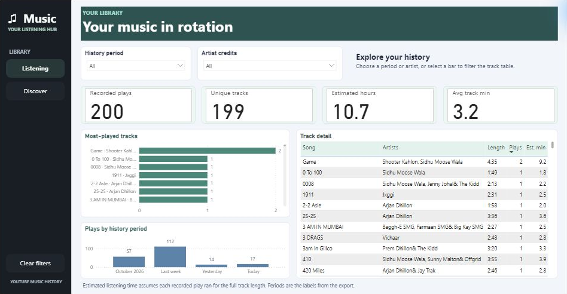
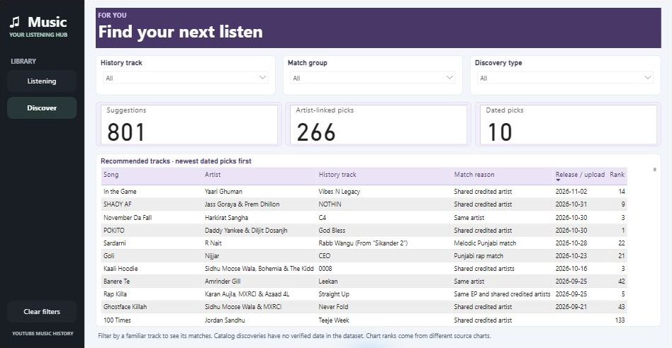

# YouTube Music Listening and Discovery

A two-page Power BI report that explores YouTube Music listening history and surfaces tracks to discover.

## Report pages

- **Listening overview** shows recorded plays, unique tracks, estimated listening time, the most-played tracks, and plays by history period. Filter by history period or artist credits to explore individual tracks.
- **Discover music** lists suggested tracks with artist matches and release or upload dates where available. Filter by discovery type, match group, or the listening-history track that inspired a suggestion.

## Screenshots

### Listening overview

### Discover music

## Project files

| File | Contents |
| --- | --- |
| [Power BI report](report/YouTube%20Music%20-%20Listening%20and%20Discovery.pbix) | Interactive report with its data embedded |
| [Cleaned dataset](data/youtube_music_history_cleaned.csv) | 1,000 records comprising 199 listening-history entries and 801 suggested tracks |
| [Data-cleaning notebook](notebooks/data_cleaning.ipynb) | pandas and NumPy workflow that trims text, drops entirely empty columns, fills missing play counts with zero, and preserves other missing values |

## Open the report

Download the PBIX and open it in Power BI Desktop on Windows. Use the **Listening** and **Discover** buttons to switch pages and **Clear filters** to reset the current page.

## Run the cleaning notebook

To regenerate the cleaned CSV, supply your own copy of the original input as `data/youtube_music_history_expanded.csv`. The repository includes the cleaned output. Install Jupyter, pandas, and NumPy, then open `data_cleaning.ipynb` with the kernel running from the `notebooks` folder and run all cells. The notebook writes to `data/youtube_music_history_cleaned.csv`.
